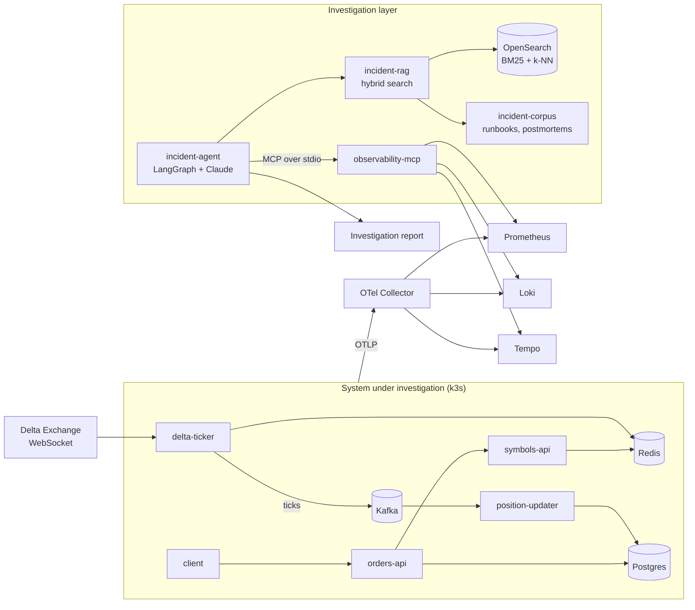

# incident-investigator

[](../../actions/workflows/ci.yml?query=branch%3Amain)
[](../../actions/workflows/ci.yml?query=branch%3Amain)
[](../../actions/workflows/ci.yml?query=branch%3Amain)
[](../../actions/workflows/ci.yml?query=branch%3Amain)

[](market-data-service/README.md)
[](market-data-service/README.md)
[](order-service/README.md)
[](order-service/README.md)

**An LLM agent that investigates production incidents the way an on-call engineer does.** It reads live metrics, logs and traces, checks what the team's runbooks and past postmortems say, and writes a report with a timeline, the evidence, a root cause with a confidence level, and recommended actions.

It runs against a real, fully instrumented system: a Kafka-based paper-trading stack for Delta Exchange options, deployed on Kubernetes with OpenTelemetry end to end.

```sh
make -C agent run Q="Positions don't seem to be getting fresh prices"
```

## Contents

- [What it does](#what-it-does)
- [Architecture](#architecture)
- [Components](#components)
- [Results](#results)
- [Design decisions](#design-decisions)
- [Quick start: run an investigation](#quick-start-run-an-investigation)
- [Running the stack](#running-the-stack)
- [Observability](#observability)
- [CI](#ci)

## What it does

When something goes wrong, most of an investigation is the same loop: check alerts, query the metrics that matter, find the error logs, follow a trace across services, and compare what you see with incidents you've had before. This project automates that loop.

1. **You describe the symptom** in plain language, e.g. *"orders-api is returning 503s"*.
2. **The agent gathers evidence** from live telemetry through an MCP server over Prometheus, Loki and Tempo.
3. **It consults past experience:** hybrid search over a corpus of runbooks and postmortems tells it *what to check*. It adopts a documented cause only when the telemetry confirms it, because similar symptoms often have different causes.
4. **It writes a Markdown report:** summary, timeline, evidence, root cause with confidence, related documents, and recommended actions.

## Architecture



The agent is a small LangGraph state graph:

```
START → agent ⇄ tools
          │
          ├─ no tool calls ───────────────────────────→ END (the report)
          └─ over the tool budget → out_of_budget → agent → END
```

Tool calls in one turn run concurrently. After the tool budget (25 rounds by default) the pending calls are answered with "write your report now", so even a long investigation always ends with a report.

## Components

**Investigation layer**

| Directory | What it is |
|---|---|
| [`agent/`](agent/README.md) | LangGraph agent (Claude) that investigates incidents with the observability MCP tools and the RAG retriever, and writes a report |
| [`observability-mcp/`](observability-mcp/README.md) | MCP server with read-only tools for Prometheus queries, Loki log search and Tempo trace lookup. Also registered for Claude Code in [`.mcp.json`](.mcp.json) |
| [`rag/`](rag/README.md) | Chunking, embedding and hybrid retrieval (BM25 + vectors in OpenSearch, pgvector), with evals for chunking strategies, backends and reranking |
| [`incident-corpus/`](incident-corpus/README.md) | Runbooks and postmortems for this stack, the agent's "past experience" |

**System under investigation**

| Directory | What it is |
|---|---|
| [`market-data-service/`](market-data-service/README.md) | `delta-ticker` streams Delta tickers to Kafka and Redis; `symbols-api` on `:8000` |
| [`order-service/`](order-service/README.md) | `orders-api` (paper positions in Postgres) on `:8001`; `position-updater` prices them from the Kafka ticker feed |
| [`infra/`](infra/README.md) | Shared Redis, Kafka and Postgres on the `portfolio` Docker network |

**Platform**

| Directory | What it is |
|---|---|
| [`deploy/k8s/`](deploy/k8s/README.md) | The whole stack on the local k3s (Rancher Desktop), with Kustomize |
| [`deploy/observability/`](deploy/observability/README.md) | Prometheus, Grafana, Loki, Tempo and the OTel Collector on the same k3s, with Helm (`make obs-up`) |
| [`scripts/smoke-test.sh`](scripts/smoke-test.sh) | End-to-end check of a running stack, on Compose or k3s |

## Results

**Retrieval**, measured on a 57-question eval set written the way an on-call engineer asks, covering all 20 corpus documents. Details in [`rag/README.md`](rag/README.md).

| Setup | Recall@1 | Recall@3 | MRR@10 | Latency (p50) |
|---|---|---|---|---|
| Vector search (pgvector / OpenSearch k-NN) | 56% | 89% | 0.73 | <1 ms |
| BM25 | 61% | 82% | 0.73 | 4 ms |
| **Hybrid BM25 + vector (chosen)** | **72%** | 88% | **0.81** | **6 ms** |
| Hybrid + MiniLM cross-encoder reranker | 74% | — | 0.81 | ~1.5 s |

All rows use the chosen chunking, `heading-merged+ctx`. It had the best recall at equal token budgets among 8 strategies (93% Recall@1000 tokens).

**Agent cost:** a typical investigation makes about 14 model calls. Prompt caching serves about 88% of input tokens from cache, because the system prompt and tool definitions never change between calls.

<!-- TODO: add end-to-end agent results here, e.g. "Correct root cause in X of N injected incidents, ~$Y and Z s per investigation", and link a sample report. -->

## Design decisions

- **Hybrid search, no reranker.** Hybrid search moves the right answer to rank 1 far more often than vectors alone (Recall@1 56% → 72%). BM25 catches exact identifiers like `NOT_ENOUGH_REPLICAS` or `exit code 137`; vectors catch paraphrases. A cross-encoder reranker added nothing measurable on top of hybrid at about 250× the latency, so it's left out until the corpus grows.
- **Heading-aware chunks with a breadcrumb.** Each chunk is a section of a runbook prefixed with its path (`RB-005: PostgreSQL connection pool exhaustion > Triage`). Without the breadcrumb, heading chunks did worst of all; with it, they did best.
- **Fetch the whole runbook when a procedure is needed.** Answers like "what's wrong and how do I fix it" span Triage and Mitigation sections that no single chunk holds, so the agent has a tool to read the full document once a chunk hits.
- **Runbooks guide, telemetry decides.** The corpus's postmortems deliberately share symptoms with new incidents but not causes, so the prompt tells the agent to confirm any documented cause against live data. The agent's golden-set incidents are kept out of the corpus to keep evals honest.
- **One MCP session per run.** The agent starts the MCP server once and keeps the session open, instead of starting a server process for every tool call.
- **A bounded investigation.** A tool budget caps cost and time, and the out-of-budget node still produces a report from what was gathered.

## Quick start: run an investigation

```sh
make k8s-start                        # the stack under investigation, on k3s
make obs-up                           # Prometheus, Loki, Tempo, Grafana
make -C observability-mcp install     # the MCP server the agent starts
make -C rag ingest                    # the corpus in OpenSearch (or use --rag-backend memory)
export ANTHROPIC_API_KEY=...

make -C agent install
make -C agent run Q="Positions don't seem to be getting fresh prices"
make -C agent run Q="orders-api is returning 503s" ARGS="--verbose"
```

Progress goes to stderr and the report to stdout, so `agent/.venv/bin/incident-agent "..." > report.md` keeps only the report. [`agent/README.md`](agent/README.md) has the configuration options.

## Running the stack

There are two ways to run the whole stack locally. They keep separate data and can run side by side, but together they use about 2 GB of memory, so usually run one at a time.

### On the local k3s (Rancher Desktop)

Run these from the repo root; `make help` lists them. They call the targets in [`deploy/k8s/Makefile`](deploy/k8s/Makefile).

| Command | What it does |
|---|---|
| `make k8s-start` | Start the stack and wait until every pod is ready. Images are built only if they don't exist yet. Works after `k8s-stop`, and on a fresh cluster |
| `make k8s-stop` | Scale every workload to 0. Config, ingress and data volumes are kept, so the next `k8s-start` comes back with the same positions and symbols |
| `make k8s-status` | Pods, services, ingress and volumes |
| `make k8s-deploy` | Rebuild both images and roll them out. Use this after changing code; `k8s-start` keeps the images it already has |

The APIs are then at <http://orders.localhost/docs> and <http://market-data.localhost/docs>.

These need `make -C deploy/k8s <target>`:

| Command | What it does |
|---|---|
| `smoke` | Run the end-to-end smoke test in the cluster |
| `logs APP=<n>` | Follow one workload's logs, e.g. `APP=position-updater` |
| `diagnose` | Show pods that aren't ready, and recent warning events |
| `delete` | Remove all workloads but keep the data volumes |
| `delete-all` | Remove the namespace **and all its data** |

For a start-to-finish example, see [the k3s walkthrough](deploy/k8s/README.md#walkthrough-deploy-trade-clean-up). It deploys the stack, creates positions and checks them, deletes them, and removes the stack. [`deploy/k8s/README.md`](deploy/k8s/README.md) has the rest of the details.

### With Docker Compose

| Command | What it does |
|---|---|
| `make -C order-service up` | Start everything: shared infra, market-data-service and order-service |
| `make -C order-service down` | Stop order-service. Infra and market-data-service keep running |
| `make -C market-data-service down` | Stop market-data-service |
| `make -C infra down` | Stop Redis, Kafka and Postgres. Data volumes are kept |

The APIs are then at <http://localhost:8001/docs> (orders) and <http://localhost:8000/docs> (market data). Each service's README lists the rest of its `make` targets.

## Observability

On k3s, with the [observability stack](deploy/observability/README.md) installed (`make obs-up`), every component sends metrics to Prometheus, logs to Loki and traces to Tempo. You can explore all three in Grafana at <http://grafana.localhost>. On Docker Compose the apps still write JSON logs, but they export no metrics or traces.

| Component | Metrics (Prometheus) | Logs (Loki) | Traces (Tempo) |
|---|---|---|---|
| **delta-ticker** | `md_ws_connected`, `md_ticks_received_total`, `md_ticks_published_total`, `md_kafka_produce_errors_total{reason}`, `md_cache_write_errors_total`, `md_tick_age_seconds{symbol}` | JSON: `symbols_changed`, `ws_open`/`ws_closed`/`ws_error`, `publish_failed`, `cache_write_failed`, librdkafka messages. Ticks only at `LOG_LEVEL=DEBUG` | `v2/ticker process` per websocket update, with the Redis `SET` and the `market-data.ticker publish` under it. The trace continues into Kafka through `traceparent` |
| **symbols-api** | `http_server_request_duration_seconds` by route, method and status | JSON access log, without `/health` and `/docs` | One span per request, with the Redis calls under it. Continues orders-api's trace |
| **orders-api** | `http_server_request_duration_seconds`, `positions_created_total{side}`, `db_pool_size` / `_in_use` / `_max` / `_requests_waiting` | JSON: `position_created`, `position_rejected{reason}`, `position_deleted`, `postgres_unavailable`, access log | One span per request, with the Postgres queries and the call to symbols-api under it |
| **position-updater** | `position_updater_ticks_total{result}`, `positions_opened_total`, `position_updater_tick_age_seconds` (histogram), `db_pool_*` | JSON: `positions_opened`, `bad_message`, `tick_failed{reason}`, `kafka_error`, librdkafka messages | `market-data.ticker process` per message, continuing delta-ticker's trace, with the Postgres `UPDATE`s under it |
| **Postgres** | postgres-exporter sidecar: `pg_stat_activity_count{state}`, `pg_settings_max_connections`, database sizes, locks | Container stdout | Client spans only, from the apps |
| **Redis** | redis-exporter sidecar: `redis_memory_used_bytes`, `redis_evicted_keys_total`, `redis_keyspace_hits_total` / `_misses_total`, commands | Container stdout | Client spans only, from the apps |
| **Kafka** | kafka-exporter: `kafka_consumergroup_lag{consumergroup,topic,partition}`, topic and partition offsets, broker count | Container stdout | Producer and consumer spans only, from the apps |
| **Across services** | Tempo derives `traces_spanmetrics_*` (rate, errors and duration per span) and `traces_service_graph_*` (calls between services) | Every line gets `k8s_namespace_name`, `k8s_pod_name`, `service_name` | The service graph covers user → orders-api → symbols-api → Redis, orders-api → Postgres, and delta-ticker → Kafka → position-updater → Postgres |
| **Observability stack** | The collector's `otelcol_*` metrics, plus Loki, Tempo, Prometheus, Grafana, kube-state-metrics and node-exporter | Container stdout | — |

- **How to query:**
  - Every app log line has `time`, `level`, `service`, `event`, `message`, and `trace_id` when it was written inside a span. The fields are also Loki structured metadata, so `{service_name="orders-api"} | event="position_rejected"` works without `| json`.
  - App metrics carry `job="incident-investigator/<service>"`. Infra metrics carry `job="postgres"`, `"redis"` or `"kafka-exporter"`.
- **Querying it from a model:** [`observability-mcp`](observability-mcp/README.md) exposes all three backends as MCP tools.
- **Where the details are:** each metric is described in [deploy/k8s/README.md](deploy/k8s/README.md#observability). How it's collected is in [deploy/observability/README.md](deploy/observability/README.md).

## CI

[`.github/workflows/ci.yml`](.github/workflows/ci.yml) runs on every push to `main`, every pull request, and on demand. A new push cancels the run already in progress for the same branch.

| Job | What it checks |
|---|---|
| Lint | `ruff check` with [`ruff.toml`](ruff.toml): pyflakes, likely bugs and import order. Also checks that every compose file is valid, runs shellcheck on `scripts/`, and renders the k8s manifests with `kubectl kustomize` |
| Test market-data-service | Unit tests with branch coverage. Fails below 80%; it's at 83% now |
| Test order-service | Unit tests against a real Postgres 18 service container, with branch coverage. Fails below 95%; it's at 100% now |
| Test observability-mcp | The MCP server's tools against fake Prometheus, Loki and Tempo, with branch coverage. Fails below 90%; it's at 98% now |
| Build | Builds each service's runtime image with a layer cache. Nothing is pushed |
| Smoke test | Runs after the four jobs above pass. Starts the real stack (infra, the symbols API, order-service) and runs `scripts/smoke-test.sh` |
| Publish badges | Pushes and manual runs on `main` only. Turns the results above into the README badges (see [Badges](#badges)) |

The smoke test doesn't start `delta-ticker`, so CI never depends on Delta Exchange being reachable. It publishes its own ticks to Kafka instead. It creates a position, checks that the first tick sets `entry_price` from the ask and the next sets `current_price` from the bid, then deletes the position.

Each test job writes a coverage table to the run's summary page. It also uploads `coverage.xml`, the HTML report and `junit.xml` as artifacts, kept for 14 days.

### Badges

The badges at the top of this README come from the latest run on `main`.

- **CI** is GitHub's own badge for the whole workflow.
- **The others** are made by the `badges` job with [`scripts/badge.py`](scripts/badge.py), from that run's job results, JUnit files and `coverage.xml` files. They're force-pushed to the `badges` branch as a single commit, so they never add commits to `main`.
- **When a job fails,** its badge turns red. The tests badge then shows how many tests failed, and a coverage report that was never produced shows as grey "unknown".
- **Links are relative** (`../../raw/badges/...`), so they work in any fork or under any repo name, and in a private repo for anyone who can view it.
- **Before the first run on `main`,** the `badges` branch doesn't exist, so these images appear broken.

[Dependabot](.github/dependabot.yml) opens weekly PRs for Python dependencies, base images and actions.

### Running the same checks locally

```sh
docker run --rm -v "$PWD":/src -w /src ghcr.io/astral-sh/ruff:0.16.9 check .   # lint
make -C market-data-service coverage
make -C order-service coverage             # starts infra if needed, for Postgres
make -C order-service up && scripts/smoke-test.sh      # smoke test on Docker Compose
make k8s-start && make -C deploy/k8s smoke             # smoke test on k3s
```

On Docker Compose, if `delta-ticker` is running while you run the smoke test, it may briefly try to subscribe the test symbol `C-SMOKETEST-1-311299` on Delta. To avoid that, stop it with `docker stop delta-ticker` first. The k3s `smoke` target does this for you.
